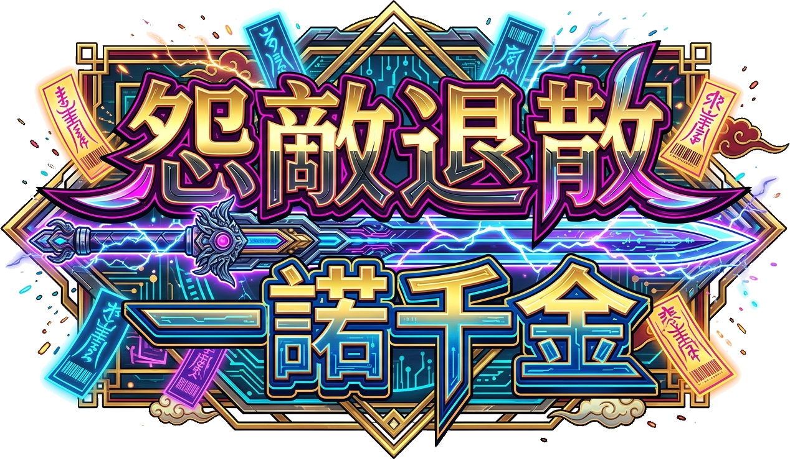
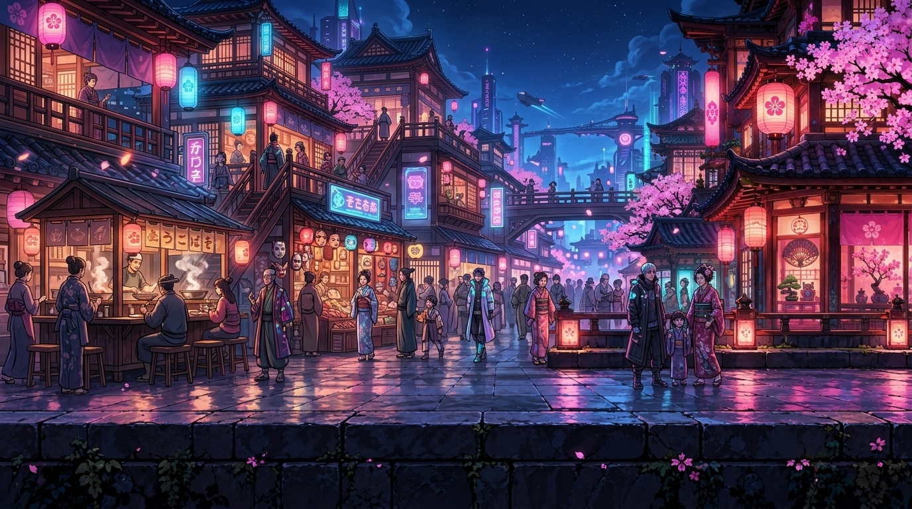

  

# 1SEC SWEEPER ― 一秒の掃除人

**その1秒で、街を守れ。ついでに、組合長の話も聞いてくれ。**

体内時計 × 電撃剣 × 街防衛。サイバーな商店街を舞台にした、**無料のブラウザアクションゲーム**です。1SECシリーズ第二弾、Version **1.00**。

## ▶ 今すぐ遊ぶ

### [ゲームをプレイする](https://YOUR-USERNAME.github.io/1sec-sweeper/)

<!-- 公開後、上のURLを実際のプレイURLへ差し替えてください。 -->

**スマホ・PCのブラウザからプレイ。ダウンロード・インストール不要。**

## 1秒を測る。それだけなのに、指が離せない。

操作の中心は、アタックボタンを**押して、1秒で離す**こと。

早すぎても、遅すぎてもダメ。ちょうどいい瞬間に指を離すと、電撃剣が唸りを上げて敵を斬り払います。でも、時計だけを気にしている暇はありません。迫るスライム、頭上を飛ぶバット、拳を振り上げる巨大な敵。そして背後には、絶対に壊されたくない街の防衛装置。

「あと少し待つか」「今、斬るか」「先に間合いを取り直すか」。シンプルな操作に、判断と欲張りが詰まっています。

しかも、いいところで組合長が横から一言。

> 「レナ、足元よし！ 剣よし！ 俺のつまみは……誰が食った！」

**集中したいのに、応援がうるさい。そんな街を、あなたは守れますか？**

## あらすじ ― 街の平和と、私の小遣いのために。

ネオンと昔ながらの商店街が同居する電子都市、**クロック・タウン**。

ある日、防衛システムの異常によって、エネルギーを喰らうモンスター「シャドウ・グリッチ」が大量発生しました。敵の群れが向かう先は、街を守る最後の防衛ライン。

頼みの綱は、特殊な電撃剣を扱うトラブルシューター、**レナ**です。剣の力を引き出す鍵は、ぴったり「1秒」のチャージ。街の人々の期待と、ちゃっかりした商店街の組合長の声援を背負い、レナは大剣を担いで駆け出します。

掲げる言葉は「怨敵退散」。交わした約束は「一諾千金」。

街を救えば、きっと相応の報酬が待っているはず。……たぶん。

## この街の人たち

### レナ ― 一秒の掃除人

バグもモンスターも電撃剣で片づける、凄腕のトラブルシューター。かわいい見た目で、大剣を振り上げれば豪快そのもの。街の平和はもちろん大切。でも、働いたぶんのお小遣いだって大切です。

指先の1秒に、レナの一撃を託してください。

### 組合長 ― 応援はタダ。改造は別料金！

声は大きい。酒には弱い……とは限らない。とにかく瓶が空になるのは早い。住人を巻き込んで応援しながら、ときどき自分のつまみや勘定の心配も始める、商店街のにぎやかなまとめ役です。

> 「組合長も戦って！」
> 
> 「俺はな、声で後方支援してるんだ！」

頼もしいのか、調子がいいだけなのか。レナの活躍には大喜びするくせに、強化パーツの代金はきっちり請求します。

それでも、いざというときには街を守る装置を用意する一面も。**口も財布も一筋縄ではいかないけれど、この街を大事にしていることだけは確か**です。

### 街の住人たち ― 声援も、酒盛りも、全力。

拍手、差し入れ、横断幕。応援に駆けつけたはずが、そのまま酒盛りを始める人もいます。危機の最中でもマイペースな人々との掛け合いが、戦いをにぎやかに彩ります。

## ここが気持ちいい！

- **JUSTの一撃。** 1秒ぴったりを狙って放つ、強力な電撃斬撃。精度が威力につながります。
- **間合いの駆け引き。** 剣を溜める間にも敵は迫ります。左右移動と攻撃の決断が、街を守る鍵です。
- **100％フィーバー。** 攻撃成功でタンクを溜め、一気に解放。振り上げた剣から稲妻が走り、画面内の敵をまとめて攻撃します。
- **稼いで、選んで、強くなる。** クリア報酬を攻撃・後退軽減・無双強化へ。限られたGの使い道も腕の見せどころ。
- **大きな敵にも、最後まで油断できない。** 拳、尻尾、そして決着の先の最後の勝負。終盤まで、自分の1秒を信じてください。
- **ネオンの街と、にぎやかな音。** サイバー×アジアンな背景、電撃演出、場面ごとのBGM。歌付きのオープニング「紫電一諾」とエンディング「Hero On Strike」は、タイトルのミュージックプレイヤーで歌詞も楽しめます。

## 4つのフェーズ

| フェーズ | エリア | どんな戦い？ |
| --- | --- | --- |
| **01** | **ビギナー・ストリート** | 商店街へ押し寄せるスライムの群れ。まずは1秒の感覚と、近づかれすぎない間合いをつかもう。 |
| **02** | **トリック・路地裏** | スピードバットが参戦。地上だけ見ていると、頭上を抜けられるかも。斬る位置とタイミングを見極めよう。 |
| **03** | **デンジャー・ハイウェイ** | 硬いヘビーゴーレムと、ほかの敵との混成戦。パンチの予備動作を見ながら、JUSTとフィーバーで道を開け！ |
| **04** | **サイバー・コア** | 巨大なボクサーカンガルーとの決戦。ジャブ、ストレート、アッパー、尻尾攻撃。接近を待たず攻撃してくる強敵を攻略しよう。 |

エリアをクリアすると強化ショップへ。**最後の敵を倒しても、まだ気を抜かないで。** 街の命運とハイスコアがかかった、1秒間のガード連打が待っています。

## 操作方法

| やりたいこと | スマホ | PC |
| --- | --- | --- |
| 左右へ移動 | 左右ボタン | `A` / `D` または `←` / `→` |
| チャージして攻撃 | ATTACKを長押し→離す | `Space`を長押し→離す |
| フィーバー発動 | 満タン時にフィーバーボタン | 満タン時に`F` |
| 一時停止 | 一時停止ボタン | `P` |
| オプション | 画面上部のメニューボタン | メニューボタン または `Esc` |
| 最後のガード | ガードボタンを連打 | `Space`を繰り返し押す |

### 1秒の判定

| 判定 | チャージ時間 | 通常攻撃の威力 |
| --- | --- | --- |
| **JUST** | 1秒 ±0.05秒 | 基礎威力の **3倍** |
| **GREAT** | 1秒 ±0.15秒（JUSTを除く） | **1.9倍** |
| **GOOD** | 1秒 ±0.25秒（JUST・GREATを除く） | **1倍** |
| **MISS** | 上記の範囲外 | 攻撃失敗・硬直 |

1.6秒まで押し続けると自動でMISSになります。JUSTでも攻撃範囲は広がらないため、しっかり間合いを合わせましょう。被弾と接触ではレナが後退し、防衛装置を壊されるとゲームオーバーです。

### 強化は3種類、各10段階

| 強化 | 効果 |
| --- | --- |
| **攻撃** | 電撃剣の威力を上げる。 |
| **後退距離軽減** | 被弾で押し戻される距離を短くする。 |
| **無双強化** | フィーバーゲージの上昇量と解放時の威力を高める。 |

強化できるのはクリア後のショップ。敗北すると所持Gは失いますが、**同じプレイ中の強化は保持**してPhase 1から再挑戦できます。

## 目指せ、最高の1秒。

クリアだけで終わらせたくない人は、JUSTを重ねてスコアに挑戦。最後のガード連打数が最終スコアの倍率になります。

「もう1回だけ。さっきより、きっと合う。」

そんな1秒を、ぜひ楽しんでください。遊んだ感想、好きな組合長の台詞、クリアの喜びも大歓迎です。**この街を、あなたの指先で守り抜け！**

## プレイ前のメモ

- **スマホは縦画面がおすすめ。** ショップとエンディングは下へスクロールして、ボタンを選べます。
- **音が出ないときは画面をタップ。** 初回はブラウザが自動再生を止めることがあります。「オープニングを再生」でも開始できます。
- **オプションで音量や演出を調整。** 1秒ガイドの継続表示、発光・揺れの軽減も選べます。
- **進行の保存機能はありません。** ページの再読み込み・終了で、進行や強化はリセットされます。
- **別のアプリへ移ったら一時停止。** 戻ってオプションを閉じると再開できます。

## ライセンス

**MIT License**。利用・改変・再配布は[LICENSE](LICENSE)に従って行えます。

---

**1SEC SWEEPER ― 一秒の掃除人 / Version 1.00**  
怨敵退散。一諾千金。――応援はタダ、改造は別料金！
